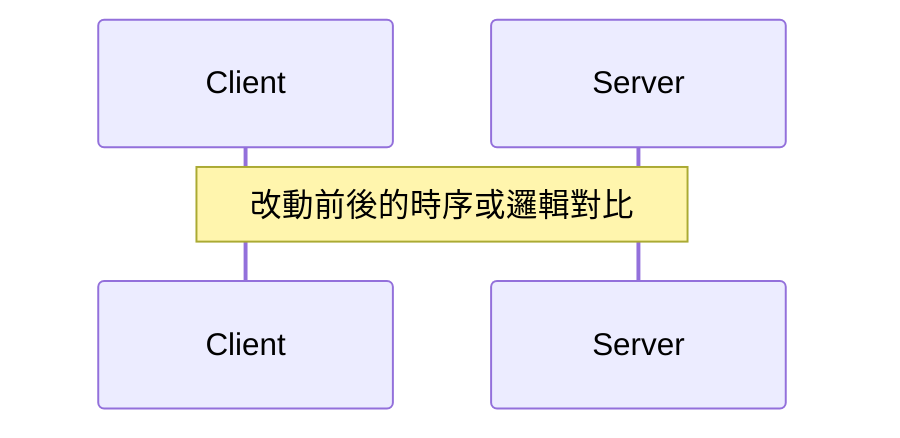

# Done or Not（成果白話判定與實證規範）

本技能規範 Agent 向使用者回報工作進度與完工成果的格式、驗證標準與歸檔機制。

核心目標：**讓所有利害關係人（無論是產品經理還是架構師）在 30 秒內一眼掌握「真實交付狀態、需要人類做什麼、有哪些限制與風險、能否安心收工」，同時在專案中留下完整、可溯源且具備因果鏈的硬核技術實證。**

---

## 1. 生效機制與情境分流（Scope & Trigger Modes）

依據使用者的觸發意圖，自動分流為兩種模式：

1. **進度詢問模式（Progress Mode）**：
   - 觸發：使用者單純詢問「進度如何」、「你現在在看什麼」、「進行到哪了」。
   - 行為：僅在對話中回傳 2~4 行的輕量 HUD 摘要（參照**模板 A-Lite**），**不產生磁碟變更，不寫入工件**。
2. **完工回報模式（Completion Mode）**：
   - 觸發：任務完工、階段里程碑、使用者詢問「done or not」、「做完了沒」、「are we done」。
   - 行為：在對話端輸出 **Executive HUD 儀表板**（參照**模板 A**），並同步將 **深度實證卷宗** 持久化寫入檔案（參照**模板 B**）。

---

## 2. 雙層回報架構（Dual-Layer Protocol）

回報採用職責分離的雙軌架構：

```
[對話端 Chat Stream]                      [磁碟工件 Artifact Layer]
┌───────────────────────────────┐         ┌──────────────────────────────────────┐
│  Executive HUD (緊湊儀表板)    │ ──────> │  歷史實證卷宗 (.reports/history/...)  │
│  • 白話產品影響 (首句人話)    │ 可點擊連結│  • 現象、已證實原因與架構取捨        │
│  • 核心架構機制 (保留精確術語)│         │  • Mermaid 邏輯變更圖                │
│  • 影響半徑與已知盲區         │         │  • 多維度影響半徑 (含 API/DB/事件)   │
│  • 四大終極判決 (Verdict)     │         │  • 驗證矩陣與原始 Log 證據錨點       │
│  • 選項化決策 (附帶推薦標記)  │         │  • 技術債清單與回滾策略 (Rollback)   │
│                               │         │  • Git Commit Hash 與環境快照        │
└───────────────────────────────┘         └──────────────────────────────────────┘
```

1. **對話端（HUD）**：首句以白話開宗明義說明產品/業務影響；技術指標區允許使用精確專業術語（如 TTL、競態條件、交易邊界），避免模糊化技術本質。不設死板行數限制，以完整傳達決策關鍵風險為準。超連結使用標準格式 `file:///{歷史報告絕對路徑}`（Windows 環境使用三斜線）。
2. **磁碟工件（Artifact）**：
   - 歷史存檔：`.reports/history/{YYYY-MM-DD-HHmm}-{task-id}.md`（不可覆寫，完整保留歷史）。
   - 最新捷徑：`.reports/latest-done.md`（以**直接覆寫複製**方式更新最新一次完工報告，避免 Windows 符號連結權限報錯）。

---

## 3. 六大核心受控原則

### 原則一：首句白話說明影響，正文保留精確術語
- 標題與第一句話以白話說明「**對產品或使用者行為的實際改變**」。
- 技術方案欄位**允許且鼓勵使用核心技術術語**（例如標明 *記憶體 Promise 隊列*，而非只寫 *排隊處理*；標明 *JWT TTL*，而非只寫 *登入設定*），確保技術讀者具備即時判斷力。

### 原則二：拒絕無證據的誇大主張（Honest Claims）
- 嚴禁在未執行 CI/CD 或正式環境觀測前宣稱「已全量上線」或「所有使用者均已修復」。
- 清楚區分階段：**本機修復 → 自動化測試 → 部署狀態 → 線上實際觀察**。無部署證據時，嚴格寫明「尚未部署至正式環境」。

### 原則三：獨立三大維度判決（The Verdict Protocol）
解開「完成」與「驗證」的死結，獨立評定：
1. **交付狀態**：工作範圍內的程式碼/文件是否編寫完畢（完成 / 部分完成 / 未完成）。
2. **驗證範圍**：哪些情境已驗證（附證據），哪些邊界未驗證（附原因）。
3. **交付判定（安心收工嗎）**：基於前兩者的風險綜合判定，允許依任務需要詳述理由，不限字數。

四大終極判決欄位：
| 判決項目 | 規範值 | 說明 |
|---|---|---|
| **交付狀態** | `已完成` / `部分完成` / `未完成` | 指程式碼/文件本身是否改完。 |
| **需要你做什麼？** | `無` / `{具體動作清單}` | 允許具體動作（如提供金鑰、在 Staging 驗證）。 |
| **有新技術債嗎？** | `無` / `{N 項，已記錄}` | 方案取捨造成的限制（如單機鎖未覆蓋跨 Pod）。 |
| **能安心收工嗎？** | `是` / `否` / `待確認 - {原因}` | 評估風險與交付目的後的綜合判定。 |

### 原則四：全面影響半徑模型（Full Blast Radius Model）
影響半徑不得只算直接呼叫者函數數量，必須評估：
- **程式碼直接呼叫**：符號修改與上游 Consumers。
- **跨邊界傳播**：是否影響資料庫 Schema、事件廣播、設定檔變更。
- **公開契約變更（Breaking Changes）**：API 路由、公開介面與型別定義。
- **未確認盲區**：若存在動態載入或未檢索的外部相依，強制標註「查找盲區 / 未知」，嚴禁以偽精確的數字暗示安全。

### 原則五：雙軌因果鏈與架構取捨（Causal Chain & Trade-offs）
深度工件必須具備**推論重建能力**，依任務型態分軌：
- **Bugfix 軌**：現象 → 已證實原因 → 排除的替代假說 → 修復機制 → 架構取捨與邊界限制。
- **Feature / Refactor 軌**：需求背景與現況瓶頸 → 採用架構方案 → 棄用的替代方案考量 → 架構取捨與邊界限制。
- 流程圖僅為輔助，不得以流程圖代替文字因果分析。

### 原則六：選項化決策（Recommended Decision）
凡有需要人類確認之處（超範圍改動、未測風險放行），提供編號選項，第 1 項為推薦項並標記 `（推薦）`，使用者回覆數字即可推進。

---

## 4. 輸出模板規範

> [!NOTE]
> 模板中的 `{佔位符}` 代表動態填寫內容，回報時請直接替換為實際文字，不要保留大括號。

### 模板 A-Lite：對話端進度摘要（進度詢問模式）

````markdown
### ⏳ 進度摘要：{一句話說明目前進行到哪個階段}
- **當前焦點**：`{正在處理或調查的檔案/模組}`
- **已完成項目**：{已驗證或修改完成的關鍵點}
- **下一步行動**：{預計進行的下一動作}
- **當前阻礙/等待**：{無 / 等待外部相依或人工確認}
````

---

### 模板 A：對話端白話 HUD（完工模式）

````markdown
### 🎯 成果摘要：{一句白話說明產品影響}（詳情見 [完整實證報告](file:///{歷史報告絕對路徑})）

{1~2 句說明問題現象與修復機制，保留必要核心術語。}

| 關鍵指標 | 狀態與實證摘要 |
|---|---|
| **改動範圍** | `{核心檔案清單，附帶行號}` |
| **技術方案** | `{精確核心機制，如：記憶體 Promise 隊列，非分散式鎖}` |
| **驗證強度** | `{測試命令與結果，如：48 通過，0 失敗；附帶覆蓋說明}` |
| **影響半徑** | `{呼叫者範圍；若有 API/DB/事件/設定變更須註明；未詳查標註盲區}` |

**四大終極判決 (Verdict)**

| 項目 | 結論 | 說明 |
|---|---|---|
| **交付狀態** | 已完成 / 部分完成 / 未完成 | 程式碼改動已就緒 |
| **需要你做什麼？** | 無 / {動作 1}、{動作 2} | 具體行動清單 |
| **有新技術債嗎？** | 無 / N 項（已記錄） | 方案權衡後的架構限制 |
| **能安心收工嗎？** | 是 / 否 / 待確認 | 綜合風險評估理由與未覆蓋邊界說明 |

**待確認事項**（若無則省略）
1. {動作}（推薦）— {理由與後果}。
2. {動作} — {理由與後果}。
````

---

### 模板 B：磁碟實證工件（寫入 `.reports/history/{timestamp}-{task}.md`）

````markdown
# 深度實證與變更報告

- **任務編號**：`{Task-ID}`
- **記錄時間**：`{YYYY-MM-DD HH:mm:ss}`
- **Git 基準**：Commit `{commit-hash}` (工作樹狀態：`{clean/dirty}`)
- **歸檔路徑**：`.reports/history/{timestamp}-{task-id}.md`

## 1. 根因分析與因果鏈（或架構設計動機）

> 依任務型態選擇合適軌道撰寫：

### 軌道一：Bugfix 因果鏈
- **觀察現象**：{使用者看到的錯誤或異常行為}
- **已證實原因**：{附帶代碼證據的真實根因，標明檔案行號}
- **排除的替代假說**：{分析過程中排除的其他可能原因}
- **修復機制**：{程式碼層級的具體處置手段}
- **架構取捨與限制**：{為什麼選此方案？放棄了什麼？存在什麼架構邊界？}

### 軌道二：Feature / Refactor 架構設計
- **需求背景與現況瓶頸**：{現有系統在何種情境下無法滿足需求}
- **採用架構方案**：{新設計的核心模式與執行流程}
- **棄用的替代方案**：{評估過但未採用的方案及棄用理由}
- **架構取捨與邊界**：{此設計帶來的代價或約束條件}

## 2. 邏輯與架構流向（Mermaid 視覺化）


## 3. 多維度影響半徑（Blast Radius Analysis）
- **直接修改檔案**：
  - `path/to/file.ts:42-65`
- **程式碼直接呼叫者**：
  - `caller/file.ts:18`
- **跨邊界相依評估**：
  - 公開契約 / API：無 Breaking Change（或註明更新的 Endpoints）
  - 資料庫 Schema：無變更
  - 事件廣播 / 訊息佇列：無變更
  - 環境變數 / 設定檔：無變更
- **查找方法與盲區**：{使用 AST/Grep 分析；若有動態反射或第三方呼叫無法靜態分析，如實交代盲區}

## 4. 驗證矩陣（Verification Matrix）
| 驗證主張 | 執行命令 / 測試案例 | 結果 | 實證細節與 Log 錨點 | 未涵蓋邊界 |
|---|---|:---:|---|---|
| 消除競態條件 | `npm test auth/refresh.test.ts` | ✅ 通過 | 48 passed, 0 failed (包含 line:88 併發測資) | 未涵蓋跨 Pod 叢集 |
| 型別相容性 | `tsc --noEmit` | ✅ 通過 | 0 errors | - |
| 跨平台建置 | `xcodebuild ...` | ⚠️ 未執行 | 本機無 Xcode 環境 | iOS 真機執行情況 |

## 5. 技術債與限制明細（Technical Debt & Limitations）
- **已知邊界約束**：{條列此改動在極端負載、跨進程或特定環境下的已知侷限}
- **追蹤與改善建議**：{未來若要徹底解決該限制，建議之重構方向}

## 6. 回滾策略與步驟（Rollback Plan）
- **回滾機制**：{Git revert / 切回前一 Commit / 部署前版映像檔}
- **資料相容性**：{回滾是否涉及資料庫 Migration 或持久化快取相容問題，若無寫「純無狀態程式碼，安全回滾」}
- **驗證回滾成功的指標**：{回滾後如何確認系統恢復正常}

## 7. 變更邊界核算
- **範圍內改動**：{需求清單內的改動}
- **超範圍改動**：{若有順手清理的項目，標記於此並在對話端呈報待確認}
````

---

## 5. 輸出前自檢清單（Self-Audit Checklist）

在輸出回報前，Agent 必須確認：
- [ ] 模式是否正確？純進度詢問採用模板 A-Lite 不寫磁碟，完工回報才啟動雙軌機制。
- [ ] 首句是否用「白話人話」說明產品影響，且未出現未經證實的「全量上線」誇大宣稱？
- [ ] 技術指標表格中是否保留了核心技術名詞，未將架構方案過度簡化？
- [ ] 影響半徑是否檢核了 API 契約與跨邊界相依（DB/事件/設定），並坦白標註查找盲區？
- [ ] 實證檔案是否以包含 Timestamp 的獨立檔案存檔，且 `.reports/latest-done.md` 正確覆寫？
- [ ] 報告中是否包含了因果鏈、技術債明細與回滾策略（Rollback Plan）？
- [ ] 佔位符是否使用 `{佔位符}` 防止 HTML 標籤吞字，箭頭是否使用純文字 Unicode `→`？
- [ ] Markdown 範本中的巢狀代碼塊是否使用四反引號（````）包裹？
